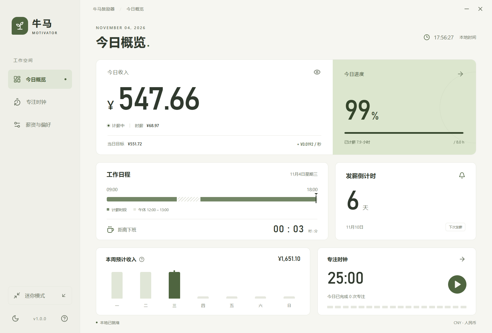

# Wage Slave Motivator · 牛马鼓励器

A quiet desktop companion that shows how much you have earned during your workday. Built with **Rust, Tauri 2, Vue 3, and TypeScript**. Works offline, with no account or telemetry.



## Download

Get the latest installers from [GitHub Releases](https://github.com/Muimi272/wage_slave_motivator/releases/latest):

| Platform                       | Package                            |
| ------------------------------ | ---------------------------------- |
| Windows x64                    | `.exe` installer                   |
| macOS, Apple Silicon and Intel | Universal `.dmg` and `.app.tar.gz` |
| Linux x64                      | `.deb` and `.AppImage`             |

Release assets include `SHA256SUMS.txt`. Builds are unsigned; macOS builds are not notarized. On Windows, the installer installs for the current user and offers WebView2 installation if needed.

The application interface is in Simplified Chinese.

## Features

- Live daily earnings calculated from your salary, paid days, and work schedule.
- Custom workdays, optional unpaid lunch, and a calendar-based payday countdown.
- Always-on-top compact mode, draggable title bar, system tray, and single-instance restoration.
- Focus and break timers with pause/resume, daily completed sessions, and restart recovery.
- Optional system notifications for lunch, the end of work, and completed timers.
- Light, dark, and system themes; one-click salary privacy.
- Local settings and records, with no network service required.

## Getting started

The first launch opens **薪资与偏好** (Salary & preferences). Set your net monthly salary, average paid days per month, workdays, working hours, lunch, and payday, then save.

Daily pay is monthly salary divided by paid days; hourly pay divides daily pay by paid working hours. Earnings are calculated from the system clock, so sleep and suspension do not introduce drift. Unselected weekdays earn nothing. The current version supports shifts within one calendar day.

The weekly figure is an estimate using your current settings: previous workdays count in full, today counts elapsed paid time, and future days are excluded. It is not a historical payroll ledger. Daily earnings reset at local midnight. Payday falls on the last day of shorter months when necessary; public holidays do not shift the date.

Use **迷你模式** for an always-on-top earnings widget. Drag its title bar to move it, and expand it or press `Esc` to return. Closing the window keeps the application in the system tray. Left-click the tray icon to restore; right-click it for settings or **退出牛马鼓励器** (Quit).

Focus and break sessions start manually. Only completed focus sessions count toward daily records. Timers recover from absolute deadlines after a restart. Reminders are off by default and require the application to be running, including in the tray.

## Development

Install Node.js 22.12+, stable Rust, and the [Tauri 2 prerequisites](https://v2.tauri.app/start/prerequisites/) for your platform. Windows requires the MSVC C++ Build Tools and WebView2.

```sh
npm ci
npm run tauri dev
```

For a browser preview, run `npm run dev` and open `http://127.0.0.1:1420`. Desktop integrations require Tauri.

```sh
npm test
npm run build
npm run format:check
cargo test --workspace
cargo clippy --workspace --all-targets -- -D warnings
cargo fmt --all -- --check
```

Desktop settings are atomically saved by Rust to `settings.json` in the system application configuration directory. Set `MOTIVATOR_DATA_DIR` to an absolute path to override that directory. Focus state, daily focus records, and salary privacy are stored in WebView local storage; the browser preview uses localStorage for settings as well.

## Build and release

```sh
# Windows
npm run release:windows

# macOS, with both Rust targets installed
npm run tauri -- build --target universal-apple-darwin --bundles dmg,app

# Linux
npm run tauri -- build --bundles deb,appimage
```

Windows release files are collected in `artifacts/release/`. Native Tauri output lives under `target/release/bundle/` (or the corresponding target directory for universal macOS builds).

On Windows, `npm run test:desktop` starts the actual release executable in WebView2 and runs a smoke test, including a real one-minute timer. Build first and close any other running instance. Test data stays inside `.qa/`; screenshots and reports are written to `artifacts/`.

The [release workflow](.github/workflows/release.yml) builds Windows x64, universal macOS, and Linux x64. A `v*` tag creates a draft, runs checks and builds on each platform, uploads packages and checksums, and publishes only when all platform jobs succeed. Failed runs leave the release as a draft. Manual dispatch can retry an unpublished tag.

Keep versions aligned in `package.json`, `src-tauri/Cargo.toml`, and `src-tauri/tauri.conf.json` before tagging a release. The application does not include an automatic updater.

## License

[MIT](LICENSE).

---

[](README.zh-CN.md)
